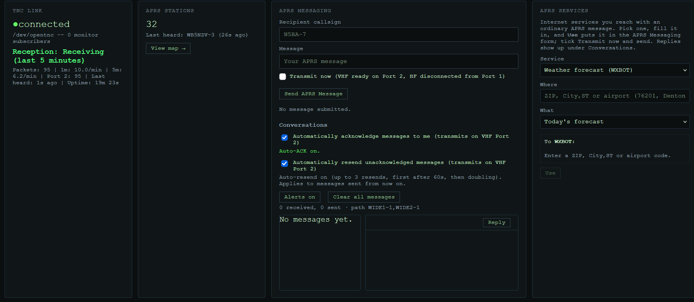
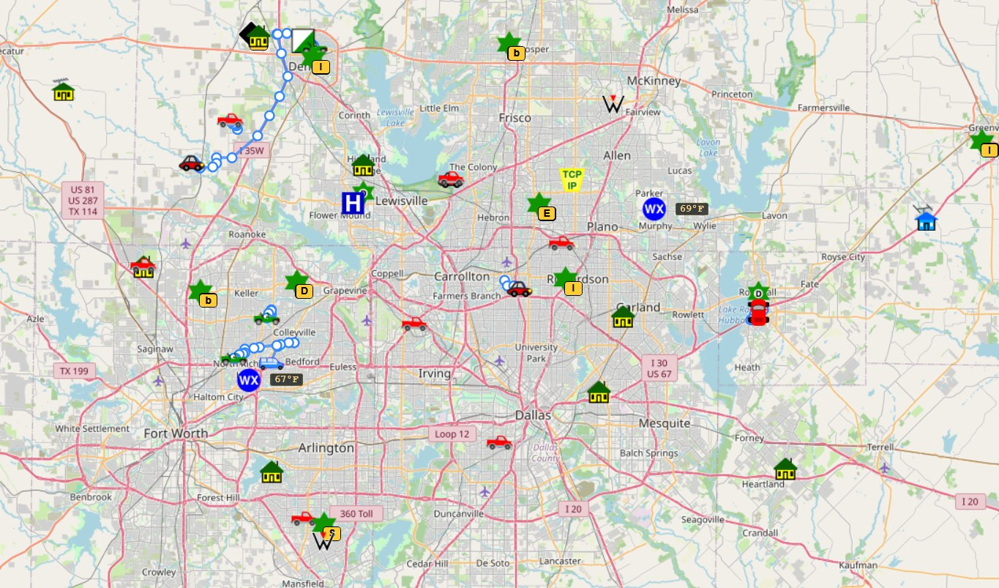

# tncstation

[](https://github.com/BoomerET/tncstation/actions/workflows/tests.yml)

<p align="center">
  
</p>

A packet radio station for hardware TNCs -- the Kantronics KAM-XL and
the NA6D OpenTNC -- or Direwolf. Three layers, each usable on its own:

- **A Python library** that drives a TNC in Terminal Mode or KISS -- a
  clean, Pythonic API instead of hand-typed terminal commands
  (`tnc.py`, with one small driver per model).
- **A background daemon** (`tncstation_daemon.py`) that owns the serial
  port: continuous monitoring, an APRS station database, messaging
  with acks and retries, beacons, persistent reception history.
- **A web dashboard** (`tncstation_rest.py`): live map, packet log,
  telemetry graphs, coverage comparison, a web terminal, phone
  notifications.





## Getting started

1. [Install](#installation) tncstation on the computer the TNC plugs
   into -- a Raspberry Pi is plenty.
2. Set up your TNC:
   - **NA6D OpenTNC:** follow [docs/opentnc.md](docs/opentnc.md) --
     OpenTNC settings, radio, levels, `.env`, first on-air tests.
   - **Kantronics KAM-XL:** a [stable device name](#persistent-serial-device-linux)
     and the [`.env` settings](#configuration) below.
   - **Direwolf** (soundcard, or an AIOC): [docs/kiss.md](docs/kiss.md).
3. [Run it as a service](#running-as-a-service), then open the
   dashboard in a browser.

## Installation

Not yet on PyPI; install from a clone, into a virtual environment
(current Raspberry Pi OS and Debian refuse a system-wide `pip install`):

```bash
git clone https://github.com/BoomerET/tncstation.git
cd tncstation
python3 -m venv .venv
.venv/bin/pip install -e .
sudo usermod -aG dialout $USER     # serial port access; log out and back in
```

Requires Python 3.10+ (tested on 3.10, 3.13 -- e.g. a Raspberry Pi -- and
3.14). The only dependency, [pyserial](https://pypi.org/project/pyserial/),
comes with it.

### Persistent Serial Device (Linux)

Linux may assign different device names to USB serial adapters
after reconnecting or rebooting. A udev rule provides a stable
device name such as `/dev/kam-xl`.

Identify your USB serial adapter:

```bash
ls -l /dev/serial/by-id/
udevadm info -q property -n /dev/ttyUSB0 | grep -E 'ID_VENDOR_ID|ID_MODEL_ID|ID_SERIAL_SHORT'
```

Create `/etc/udev/rules.d/99-kam-xl.rules`:

```udev
SUBSYSTEM=="tty", ATTRS{idVendor}=="0403", ATTRS{idProduct}=="6001", ATTRS{serial}=="A10LK78T", SYMLINK+="kam-xl"
```

Replace the identifiers with those reported for your own adapter.
The values above identify a specific FTDI FT232R USB serial adapter.
For an OpenTNC (USB ID `1209:ae6e`), `/etc/udev/rules.d/99-opentnc.rules`:

```udev
SUBSYSTEM=="tty", ATTRS{idVendor}=="1209", ATTRS{idProduct}=="ae6e", SYMLINK+="opentnc"
```

Reload udev and verify the device:

```bash
sudo udevadm control --reload-rules
sudo udevadm trigger --subsystem-match=tty
ls -l /dev/kam-xl
```

Use the stable device name in Python:

```python
from kamxl import KAMXL

kam = KAMXL("/dev/kam-xl")
try:
    kam.connect()
    print(kam.get("MYCALL"))
finally:
    kam.disconnect()
```

### Configuration

The daemon and the web server both read `.env` in the tncstation
folder. Start from the sample, which explains every setting:

```bash
cp .env.sample .env
```

The main ones:

```dotenv
TNCSTATION_TNC=kamxl                      # kamxl, opentnc, or kiss (Direwolf)
TNCSTATION_MODE=terminal                  # optional: terminal or kiss
TNCSTATION_PORT=/dev/kam-xl               # or /dev/opentnc, tcp://localhost:8001
TNCSTATION_CALLSIGN=N0CALL                # your station callsign, SSID included
TNCSTATION_HISTORY_DB=/var/lib/tncstation/reception.sqlite3   # optional: inbox + history
TNCSTATION_AUTO_ACK=1                     # optional: auto-ack received messages
TNCSTATION_APRS_PATH=WIDE1-1,WIDE2-1      # optional: digipeater path (DIRECT = none)
TNCSTATION_LATITUDE=33.2275               # optional: position beacon
TNCSTATION_LONGITUDE=-97.1273
TNCSTATION_BEACON_COMMENT=KAM-XL
TNCSTATION_BEACON=1                       # optional: beacon automatically
TNCSTATION_WATCHDOG_MINUTES=30            # optional: reception alert after N quiet min (0 = off)
TNCSTATION_AUTO_RETRY=1                   # optional: resend unacknowledged messages
TNCSTATION_REST_API_KEY=change-me         # web dashboard / API token
TNCSTATION_VERBOSE=0                      # optional: 1 = detailed (DEBUG) logging, same as --verbose
TNCSTATION_NTFY_URL=https://ntfy.sh       # optional: phone notifications
TNCSTATION_NTFY_TOPIC=your-topic
```

The daemon requires `TNCSTATION_PORT` and `TNCSTATION_CALLSIGN` rather
than guessing either. `.env` holds your dashboard token: keep it out of
git (it's in `.gitignore`).

### Running as a service

`deploy/` has systemd units for the daemon and the web server.
`deploy/install.sh` fills in your user, this folder and the `.venv`,
and installs them:

```bash
sudo deploy/install.sh               # --dry-run shows the units first
sudo systemctl enable --now tncstation-daemon tncstation-web
journalctl -u tncstation-daemon -f   # watch it start
```

Then open `http://<this-computer>:8080/?token=<TNCSTATION_REST_API_KEY>`.
After a `git pull`, restart both:
`sudo systemctl restart tncstation-daemon tncstation-web`. Using
Direwolf? Uncomment the two `direwolf.service` lines in
`deploy/tncstation-daemon.service` before installing.

### If something doesn't work

- **The web server won't start: "Port 8080 is already in use".**
  Another program has it -- Pat's web interface uses 8080, for one.
  Set `TNCSTATION_REST_PORT=8090` (or any free port) in `.env`, restart
  `tncstation-web`, and use that port in the address. `sudo ss -ltnp`
  shows what's listening where.
- **The dashboard says `Unauthorized`.** The token in the address
  doesn't match `TNCSTATION_REST_API_KEY` -- a copy-paste that dropped a
  character is the usual cause. To check the key itself, from the
  tncstation folder:

  ```bash
  key=$(grep '^TNCSTATION_REST_API_KEY=' .env | cut -d= -f2- | tr -d "\"'")
  curl -s "http://localhost:8080/status?token=$key" | head -c 80; echo
  echo "http://$(hostname -I | awk '{print $1}'):8080/?token=$key"
  ```

  (use your port). `{"ok": true` means the key is right: open the
  printed address. Still `Unauthorized`: restart `tncstation-web`, which
  reads `.env` only at startup. "Generated API key" in
  `journalctl -u tncstation-web` means it didn't find the setting at
  all.
- **An OpenTNC hears nothing, and the packet log shows only your own
  beacons:** it's at its `cmd:` prompt instead of in KISS mode. Unplug
  and replug it; see "What happens if..." in
  [docs/opentnc.md](docs/opentnc.md).
- **A Raspberry Pi reboots when the radio transmits:** check
  `vcgencmd get_throttled` -- see "Raspberry Pi power" in
  [docs/opentnc.md](docs/opentnc.md).
- Anything else: `journalctl -u tncstation-daemon -n 50` usually says
  why; [open an issue](https://github.com/BoomerET/tncstation/issues)
  with it.

## Status

Actively developed and in daily use on two stations: a KAM-XL in
Terminal Mode and an OpenTNC in KISS mode, both on 1200-baud VHF APRS.
Not yet on PyPI. See [Supported TNCs](#supported-tncs) for what's
verified on each, [ROADMAP.md](ROADMAP.md) for what's next, and the
[design history](docs/history.md) for how it got here.

## Supported TNCs

The library is split into a generic driver layer (`tnc.py`'s
`TerminalTNC`: serial I/O, commands, typed parameters, connected
mode, monitoring, Winlink) and one small subclass per TNC model. The
daemon, REST API and web pages work with any of them.

| TNC | Driver | Status |
| --- | --- | --- |
| Kantronics KAM-XL | `kamxl.KAMXL` | Verified over the air; everything works, including connected mode, PBBS and Winlink |
| NA6D / AE6EO OpenTNC, KISS mode | `opentnc.OpenTNCKISS` | Verified over the air: monitoring, map, APRS messages both ways with ACKs, beacons |
| NA6D / AE6EO OpenTNC, Terminal Mode | `opentnc.OpenTNC` | Settings and monitoring verified against the real unit and its firmware source; APRS transmit off (use KISS); connected mode untried; no PBBS (no mailbox) |
| Direwolf, KISS over TCP | `kiss.GenericKISS` | Monitoring and APRS transmit (tested with an AIOC) |

Pick one with `TNCSTATION_TNC` and `TNCSTATION_MODE` in `.env`, or
`create_tnc()` in code:

```python
from tnc import create_tnc

tnc = create_tnc("opentnc", "/dev/opentnc")
tnc.connect()
print(tnc.get_typed("MYCALL"), tnc.get_fx25())
for packet in tnc.monitor():
    print(packet.source, "->", packet.destination, ":", packet.payload)
```

In **KISS mode** the TNC passes raw AX.25 frames, so monitoring and
APRS don't depend on any display format -- but there's no web
terminal, connected mode, PBBS or Winlink, and the web pages hide
those. The pages also hide what a Terminal Mode TNC lacks (the
OpenTNC's PBBS, for one). See [docs/kiss.md](docs/kiss.md), and
[docs/opentnc.md](docs/opentnc.md) for OpenTNC setup and levels.

## Themes

Every web page has a theme picker beside its title:

- **Terminal** -- green on black, the original look (default)
- **Light** -- dark on light, for daylight and phones outdoors
- **Night (red)** -- dim red on black, including the map, to keep your
  night vision at the operating position
- **Auto** -- Light or Terminal, following the device's setting

The choice is remembered per browser, so a phone and a laptop can
differ. All colors live in `tncstation_web/_shared/theme.css` as named
tokens, one block per theme; page stylesheets only refer to tokens.

## Documentation

- [docs/quickstart.md](docs/quickstart.md) -- the library: connect,
  read/write parameters, connected mode, monitoring
- [docs/api_reference.md](docs/api_reference.md) -- full method/class
  reference
- [docs/daemon.md](docs/daemon.md) -- the background daemon: protocol,
  methods, concurrency model
- [docs/rest_api.md](docs/rest_api.md) -- the REST API and every web
  page: dashboard, map, packet log, telemetry, terminal, PBBS, Winlink
- [docs/opentnc.md](docs/opentnc.md) -- the OpenTNC: setup, levels,
  what's verified
- [docs/kiss.md](docs/kiss.md) -- KISS mode and Direwolf
- [docs/backup.md](docs/backup.md) -- nightly database backups to a
  network share, and restoring
- [docs/troubleshooting.md](docs/troubleshooting.md) -- real hardware
  quirks and how this library works around them
- [docs/history.md](docs/history.md) -- the design history, milestone
  by milestone, and the reasoning behind decisions
- [examples/](examples/) -- runnable scripts, including two that need
  no hardware at all

## Reception history

Set `TNCSTATION_HISTORY_DB` in `.env` (make sure the daemon's user can
write to that directory) and the daemon records every packet it hears
in SQLite. That powers:

- the APRS **message inbox** and saved sent messages
- the **map** coming back after a restart, and station tracks over the
  last 6 hours to 7 days
- the **packet log** (`/log`): search by sender, digipeater, text and
  period -- "when did I last hear K5XYZ, and through which digipeater?"
- the **telemetry** page: digipeater and weather-station telemetry,
  graphed with each station's own names, units and scaling
- the dashboard's **Coverage** card: compare station setups ("mag-mount
  in the garage" vs "J-pole") by how often you were digipeated or
  reached APRS-IS, and which digipeaters heard you
- the dashboard's reception charts (24 hours, 7 or 30 days)

Without it, everything still works live, but the map and inbox start
empty after a restart. Set `TNCSTATION_BACKUP_DIR` too for a nightly
backup ([docs/backup.md](docs/backup.md)). Details are in
[docs/rest_api.md](docs/rest_api.md).

## Testing

```
python3 run_tests.py
```

Runs the offline unit test suite (standard-library `unittest`, no
third-party packages required) against a scripted fake serial
connection -- no TNC hardware needed. The live hardware tests that
validated the library against a real KAM-XL over the air, and the
setup and recovery scripts, are in [tools/](tools/). GitHub also runs
`flake8 --select=F .` (unused imports, undefined names) on every pull
request.

## Design philosophy

Never write code because the manual says the KAM-XL behaves a
certain way -- write code based on observed behavior from real
hardware whenever the two differ. Several bugs were only ever found
by testing against a live KAM-XL over the air, not by reading the
manual: a stale command prompt leaking into connect/disconnect
banners, a VIA digipeat path getting truncated because a marker
matched before the rest of the line arrived, and a race between an
async link-failure notice and an unrelated command's response. The
OpenTNC driver went the same way: its monitor output looked nothing
like the TNC-2 format it was expected to print, and the parser was
rewritten from a real capture and the firmware's source.

## License

MIT -- see [LICENSE](LICENSE).
